# NinhVaNa

**Hệ thống Quản trị Doanh nghiệp Khách sạn & Nhà hàng 5 sao** — PMS, POS, Channel Manager, Revenue, Cost, HRM, Finance, CRM và BI trong một nền tảng đa cơ sở.

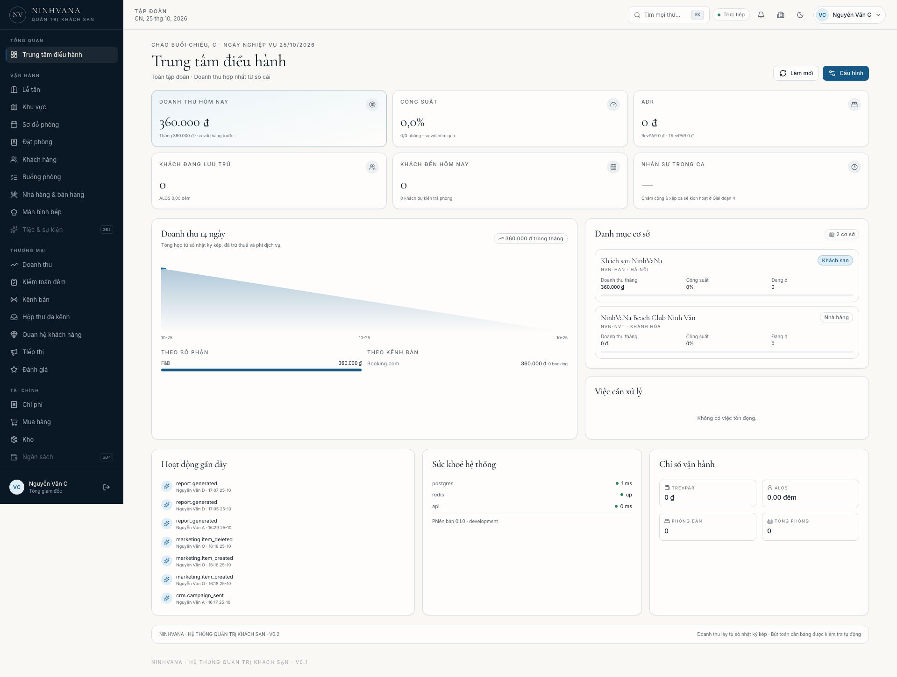

> Đa cơ sở · Đa kênh · Tài chính hợp nhất theo thời gian thực · Giao diện tiếng Việt / English

---

## Trạng thái dự án

| Giai đoạn | Nội dung | Trạng thái |
|---|---|---|
| 0 | Kế hoạch, kiến trúc, ERD, backlog | ✅ Hoàn tất |
| 1 | Nền tảng: monorepo, DB, auth/2FA, RBAC, audit, design system, seed | ✅ Hoàn tất (Gate 1) |
| 2 | PMS + Folio + POS + Night Audit + Revenue posting | ✅ Hoàn tất (Gate 2) |
| 3 | Channel Manager, Booking Engine, Social Inbox, Attribution | ✅ Hoàn tất (Gate 3) |
| 4 | Chi phí, mua hàng, kho, HRM, lương, P&L | ✅ Hoàn tất (Gate 4) |
| 5 | Dashboard KPI đầy đủ, report builder, AI, dự báo | ⬜ |
| 6 | CRM, kiểm thử, bảo mật, PWA, đóng gói | ✅ Hoàn tất (Gate 6) |

Hướng dẫn mở/test trên macOS, Windows, Android, iOS: [`docs/HUONG-DAN-TEST.md`](docs/HUONG-DAN-TEST.md).

**Rà soát module & giai đoạn:** [`docs/ROADMAP-AUDIT.md`](docs/ROADMAP-AUDIT.md).

**Chạy thử:** [`docs/TESTING.md`](docs/TESTING.md).

**Android:** [`docs/ANDROID-SETUP.md`](docs/ANDROID-SETUP.md).

**Cloudflare test:** https://ninhvana.lenguyenduylinh29031992.workers.dev ·  [`docs/CLOUDFLARE.md`](docs/CLOUDFLARE.md).

**VPS miễn phí:** [`docs/FREE-VPS.md`](docs/FREE-VPS.md).

**Triển khai 24/7:** [`docs/DEPLOY-VPS.md`](docs/DEPLOY-VPS.md) · **Offline:** [`docs/OFFLINE-SYNC.md`](docs/OFFLINE-SYNC.md).

**Grand Spa:** [`docs/GRAND-SPA.md`](docs/GRAND-SPA.md).

**Giao diện:** [`docs/UI-REFORMAT.md`](docs/UI-REFORMAT.md).

**Google Sheet sync:** [`docs/GOOGLE-SHEET-SYNC.md`](docs/GOOGLE-SHEET-SYNC.md).

**Dữ liệu thử & phiên bản:** [`docs/DEMO-DATA.md`](docs/DEMO-DATA.md) · [`docs/OS-VERSIONS.md`](docs/OS-VERSIONS.md).

**Badge theo mục:** [`docs/NAV-BADGES.md`](docs/NAV-BADGES.md).

**Loại phòng & duyệt giá:** [`docs/ROOM-TYPES-RATES.md`](docs/ROOM-TYPES-RATES.md).

**Cơ cấu bộ phận & doanh thu:** [`docs/ORG-STRUCTURE.md`](docs/ORG-STRUCTURE.md).

**Nhân sự Marketing TikTok:** [`docs/MARKETING-TIKTOK-HR.md`](docs/MARKETING-TIKTOK-HR.md).

**Giao diện di động:** [`docs/MOBILE-UI.md`](docs/MOBILE-UI.md).

**Truy cập iPhone LAN/từ xa:** [`docs/REMOTE-ACCESS.md`](docs/REMOTE-ACCESS.md).

**iOS runtime & signing:** [`docs/IOS-SETUP.md`](docs/IOS-SETUP.md).

**Bộ cài đặt desktop/mobile:** [`docs/CAI-DAT-APP.md`](docs/CAI-DAT-APP.md) · `dist/`.

Kế hoạch đầy đủ: [`docs/PLAN.md`](docs/PLAN.md) · Tiến độ & bằng chứng: [`docs/PROGRESS.md`](docs/PROGRESS.md).

---

## Khởi chạy nhanh

### Cách A — Docker Compose (khuyến nghị)

```bash
cp .env.example .env          # điền secret thật nếu triển khai ngoài local
docker compose up -d --build
```

- Web: <https://ninhvana.lenguyenduylinh29031992.workers.dev/login>
- API + Swagger: <http://localhost:4000/api/docs>
- MailHog (email demo): <http://localhost:8025>

Container `api` tự chạy migration, seed nền tảng và 30 ngày lịch sử vận hành (đặt phòng, POS, night audit) trong lần khởi động đầu.

### Cách B — Local (không cần Docker)

```bash
pnpm setup      # tạo .env.local, khởi động PostgreSQL 16 + Redis cục bộ, migrate, seed
pnpm dev        # API :4000 · Web :3000
```

Yêu cầu: Node.js ≥ 22, pnpm 11, PostgreSQL 16 + Redis (script `scripts/dev-db.sh` tự quản lý cluster trong `.dev/`, không ảnh hưởng dữ liệu hệ thống).

Kiểm tra nghiệm thu Giai đoạn 1–2:

```bash
bash scripts/check-acceptance.sh
```

---

## Năng lực Giai đoạn 2

- **Đặt phòng & chống overbooking**: Redis lock → PostgreSQL advisory lock → kiểm tra trong transaction → `EXCLUDE USING gist` trên khoảng ngày. Bài test 10 request đồng thời cho phòng cuối chỉ cho đúng 1 thành công.
- **Lễ tân**: bàn đến/đi/đang ở, nhận & trả phòng, folio, ghi phí, thanh toán đa phương thức, xuất hoá đơn GTGT in được.
- **POS & KDS**: sơ đồ bàn, menu theo outlet, gửi bếp/bar, ghi nợ phòng, thanh toán, màn hình bếp realtime.
- **Night Audit**: kết chuyển doanh thu phòng theo từng đêm, hạch toán hoa hồng OTA, khoá ngày nghiệp vụ, đối soát Nợ/Có và doanh thu bộ phận/kênh.
- **Sổ nhật ký kép**: mọi khoản phí và thanh toán đều sinh bút toán cân bằng; dashboard đọc trực tiếp từ sổ.
- **Buồng phòng**: bảng công việc tối ưu điện thoại, checklist, đổi trạng thái phòng, báo hỏng.
- **Tape chart**: 14 ngày, kéo thanh đặt phòng sang phòng khác để đổi phòng.

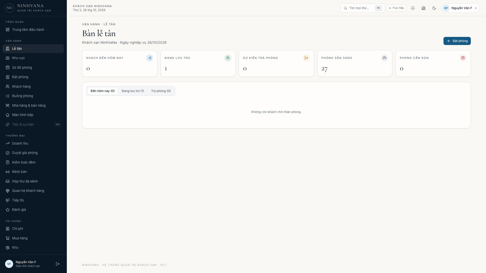

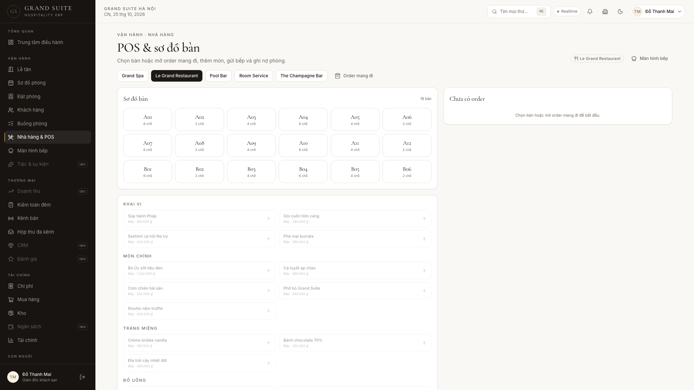

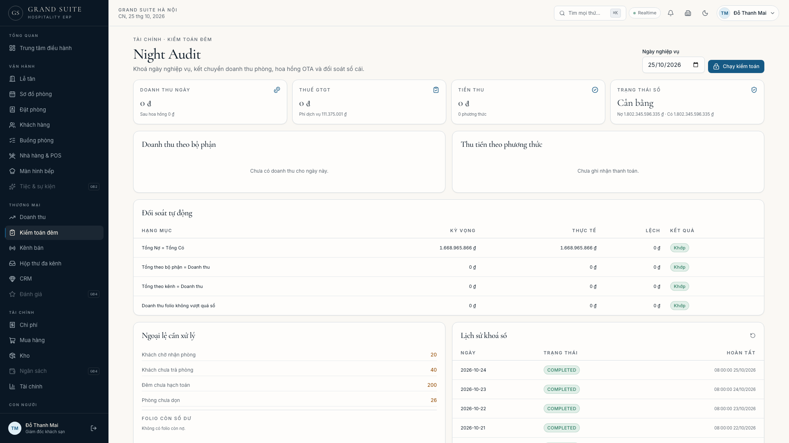

---

## Năng lực Giai đoạn 3

- **Channel Manager thật**: 8 adapter OTA (Booking.com, Agoda, Expedia, Airbnb, Traveloka, Trip.com, Google Hotel Ads, Tripadvisor) + 9 adapter social (Facebook, Instagram, Zalo, TikTok, WhatsApp, Telegram, LINE, KakaoTalk, WeChat) sau một interface duy nhất.
- **ARI 2 chiều**: đẩy tồn phòng & giá theo ngày vào hàng đợi idempotent; worker retry với exponential backoff, ghi sync log và chuyển **DLQ** khi hết lượt; đẩy lại job lỗi bằng một nút.
- **Kéo booking & webhook**: connector sinh booking thật vào PMS; webhook ký HMAC-SHA256, chống replay nhờ `(channelId, externalId)` unique — gửi lặp chỉ trả về booking cũ.
- **Booking engine công khai** tại `/book`: tìm phòng trống theo ngày, chọn hạng phòng, nhập thông tin khách, xác nhận tức thì và nhận mã đặt phòng.
- **Social Commerce Inbox**: 9 kênh chat trong một hộp thư, gán trạng thái, trả lời khách qua adapter, lưu toàn bộ lịch sử.
- **Attribution**: dashboard hiển thị doanh thu **net sau hoa hồng** và số booking theo từng kênh; mọi con số lấy từ sổ cái.

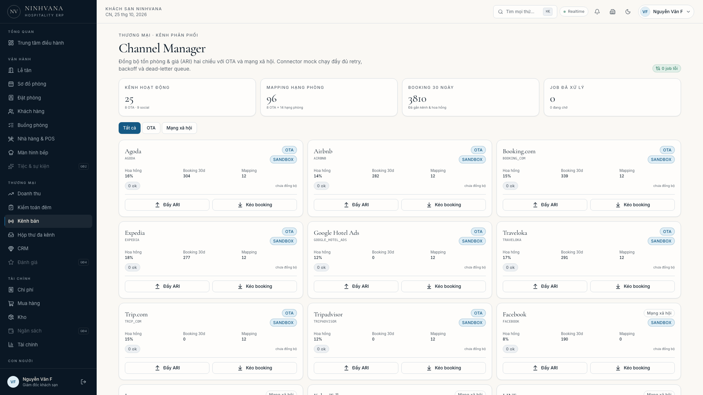

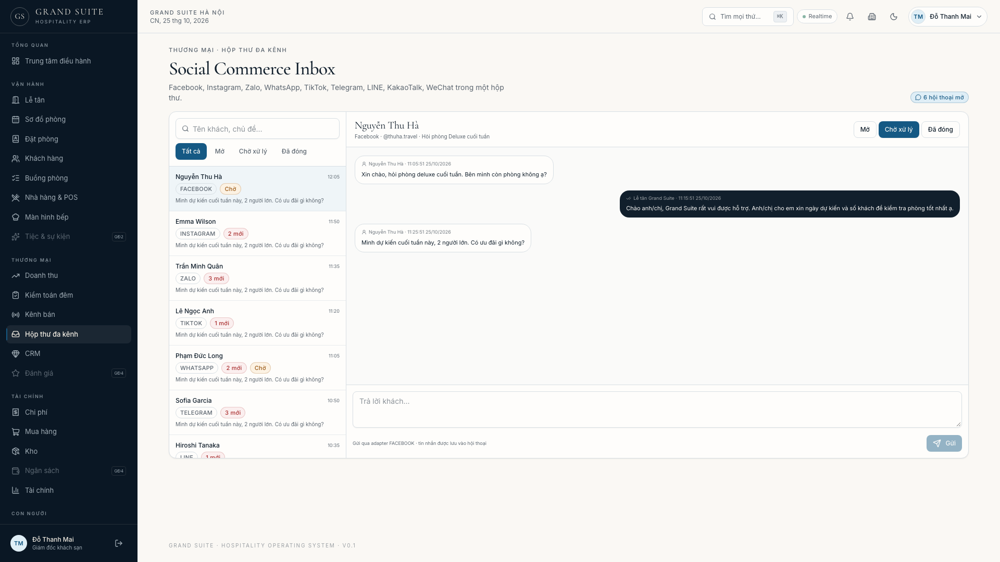

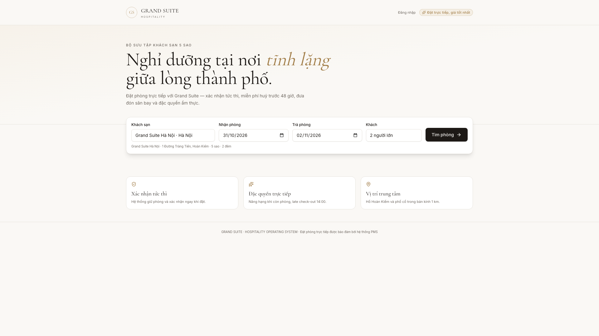

---

## Năng lực Giai đoạn 4

- **Chi phí & mua hàng**: nhà cung cấp, yêu cầu mua → đơn mua → nhận hàng → hoá đơn → thanh toán; mọi bước sinh bút toán và cập nhật kho.
- **Kho & giá vốn**: tồn kho theo mặt hàng, nhập/xuất kho, định mức tối thiểu, xuất kho về bộ phận ghi nhận COGS F&B.
- **HRM & lương**: hồ sơ nhân viên, chấm công, tính lương theo hợp đồng + tăng ca, BHXH/BHYT/BHTN/KPCĐ, thuế TNCN lũy tiến, hạch toán và chi trả.
- **P&L theo USALI**: doanh thu, giá vốn, lương, chi phí vận hành, chi phí cố định, **GOP**, **GOPPAR**, **RevPAR**, lợi nhuận sau thuế, hiệu quả từng bộ phận.
- **Báo cáo tài chính**: bảng cân đối kế toán tự cân bằng, lưu chuyển tiền tệ 3 dòng, tuổi nợ AR/AP.
- **UI**: Finance & P&L (5 tab), Cost Control (chi phí/tồn kho/công nợ NCC), HR & Payroll.

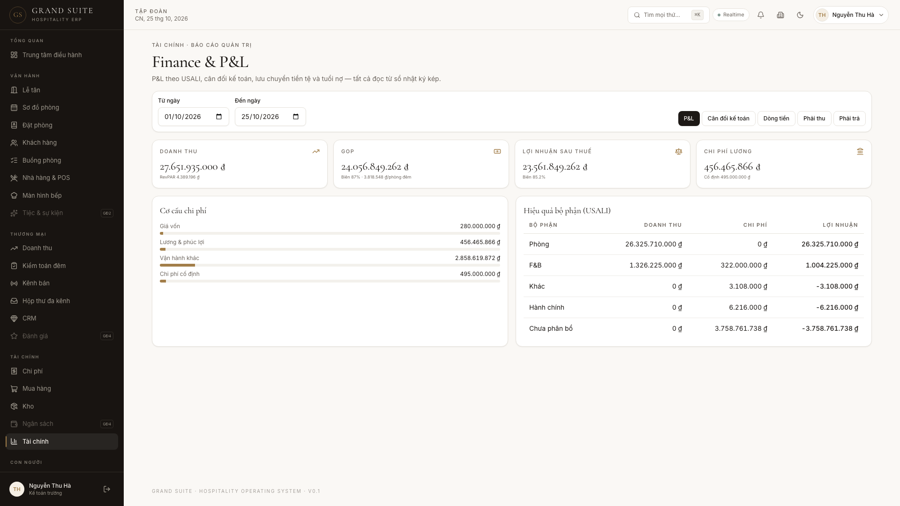

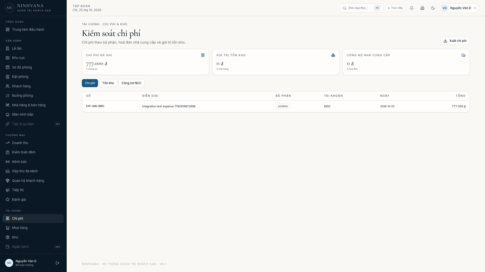

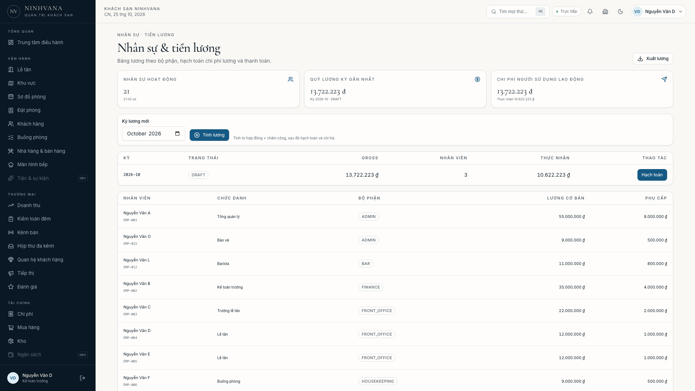

---

## Năng lực Giai đoạn 5

- **Dashboard hợp nhất**: doanh thu, GOP, GOPPAR, RevPAR, công suất, ADR, AR/AP theo toàn tập đoàn hoặc từng cơ sở; phản hồi **~150 ms** và cache 60 giây.
- **24 tháng dữ liệu**: 1.460 bút toán doanh thu theo ngày với mùa vụ + cuối tuần, 48 bút toán chi phí/tháng, đủ cho MoM/YoY và dự báo.
- **Dự báo AI**: hồi quy xu hướng + hệ số mùa vụ theo tháng, **backtest cuộn 6 tháng**, MAPE ~19,7%, khoảng tin cậy ±16%.
- **Report Builder**: 6 mẫu (P&L, bộ phận, kênh, công suất/ADR, bảng lương, tuổi nợ AP), chạy theo ngày/cơ sở, xem trước và **xuất CSV UTF-8** mở trực tiếp bằng Excel.
- **Realtime**: dashboard và các màn hình vận hành tự làm mới; WebSocket phát sự kiện booking/POS/kênh.

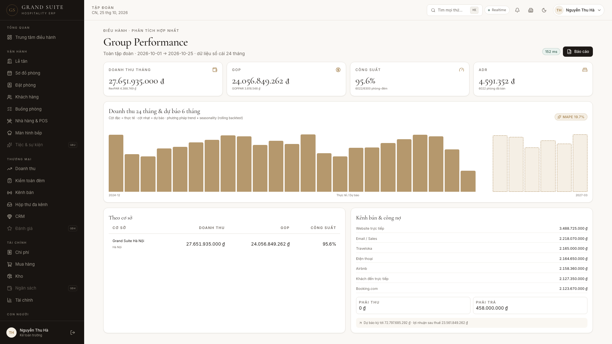

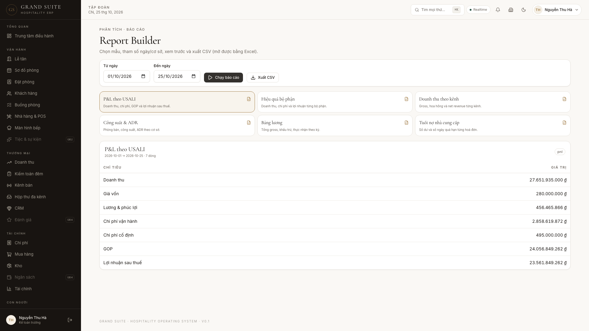

---

## CRM — Giai đoạn 6

- Phân khúc khách (VIP, quay lại, không quay lại 6 tháng), top khách theo giá trị trọn đời.
- Đánh giá sao, phản hồi của khách sạn, trạng thái xử lý, audit.
- Chiến dịch email theo phân khúc, gửi mock và đếm người nhận.
- 5 luồng browser e2e chạy thật: dashboard, đặt phòng, POS thêm món, buồng phòng, report builder.

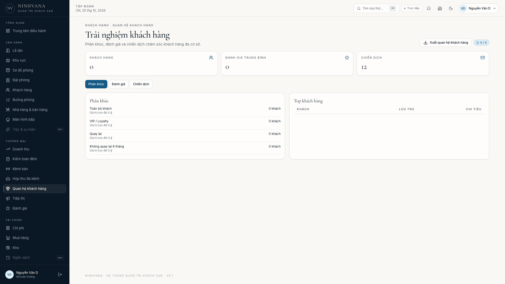

---

## Marketing Workspace & sơ đồ khu vực

- **Marketing** (`/marketing`): mục lớn → mục con chi tiết, thêm bằng nút **+** cạnh từng mục; trạng thái, kênh, ngân sách, ghi chú; cây mặc định gồm Chiến dịch, Nội dung & thương hiệu, Kênh & đối tác, Ngân sách & ROI, Chăm sóc khách hàng.
- **Sơ đồ khu vực** (`/property-map`): Khu A — Nhà chính trung tâm (A1 tầng trệt: cổng đón khách, lễ tân, 6 dormitory, hồ bơi/view biển; A2: 6 dormitory, 2 view, 1 connecting; A3: 10 phòng đôi, 2 family gác lửng, 1 sảnh chung), Khu B Bagalog, Khu C Bếp & Quầy Bar, Khu D Hồ Bơi.
- **Xuất dữ liệu**: Excel `.xlsx`, Word `.docx`, CSV UTF-8 và Google Sheets (sao chép TSV rồi dán vào `sheets.new`) cho marketing, sơ đồ khu vực, đặt phòng, khách, buồng phòng, CRM, lương, kênh, sổ nhật ký, hoá đơn NCC và tài khoản.

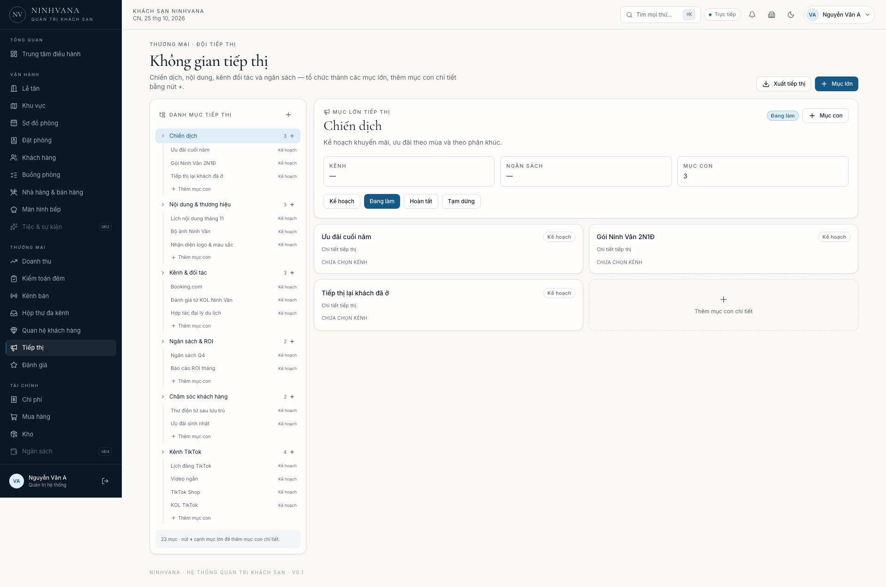
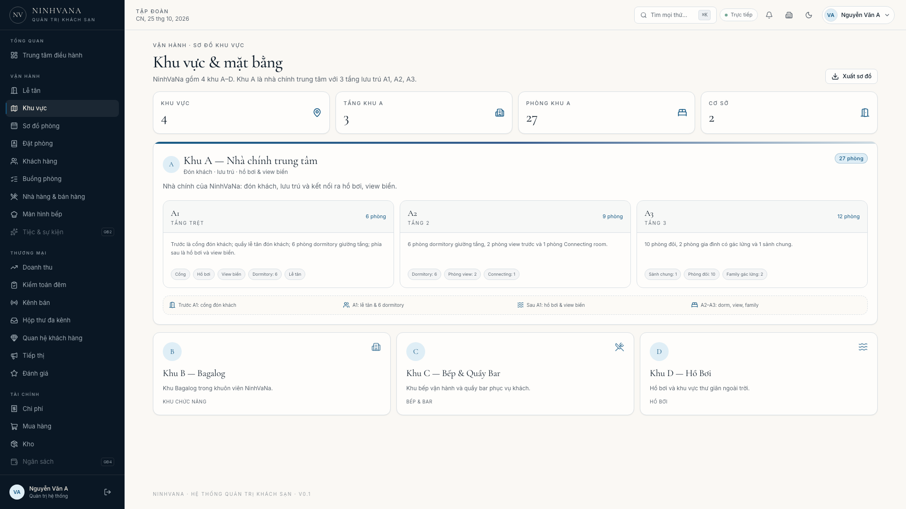

---

## Giai đoạn 6 — kiểm thử, bảo mật & PWA

- **Coverage lõi**: shared **73,5% statements / 74,9% lines**; API core (accounting, channels, finance, HR, reports, reservations, auth/locks/sequence) **73,0% statements / 77,1% lines** — vượt mốc 70%.
- **Bảo mật**: `pnpm audit --prod --audit-level high` → **0 high/critical** (2 moderate còn lại); đã override postcss, multer, deepmerge-ts, zod lên bản vá; helmet/CSP, CSRF, RBAC, audit chain và webhook HMAC đã có test.
- **Browser e2e**: 5/5 luồng PASS — dashboard, đặt phòng, POS thêm món, buồng phòng, report builder.
- **PWA**: service worker cache shell + trang `/offline`; manifest hợp lệ.
- **Docker**: đã chạy thật bằng Colima + Docker Compose; 6 service healthy, seed 24 tháng, acceptance **39/39** trong container.

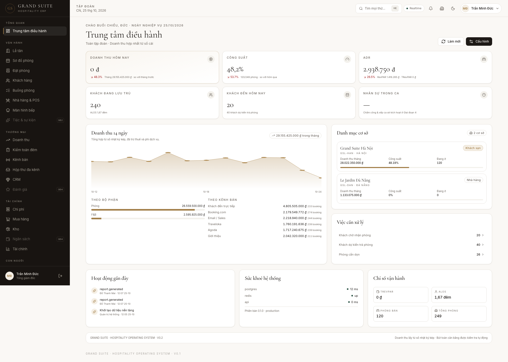

---

## Nghiệm thu Docker (Gate 6)

```bash
docker compose up -d --build
# api healthy · web healthy · db healthy · redis healthy · mailhog · backup
bash scripts/check-acceptance.sh   # 39/39
docker compose ps                  # docs/evidence/docker-compose-stack.txt
```

Bằng chứng: `docs/evidence/docker-compose-stack.txt`, `docker-seed-log.txt`, `gate6-acceptance.txt`.

---

## Xoá dữ liệu vận hành (về 0)

```bash
RESET_CONFIRM=YES pnpm --filter @grand-suite/api db:clear
```

Lệnh này xoá khách hàng, phòng, đặt phòng, folio, POS, hoá đơn, thanh toán, bút toán, lương, buồng phòng và audit; đặt số phòng + bộ đếm chứng từ về 0. **Giữ nguyên** tài khoản, vai trò, cấu hình, marketing, sơ đồ khu vực, kênh, menu, nhà cung cấp và mặt hàng. Khôi phục dữ liệu mẫu: `pnpm db:reset && pnpm db:seed:history && pnpm db:seed:finance && pnpm db:seed:long`.

## Tài khoản demo

Mật khẩu chung: **`NinhVaNa@2026`** (đổi qua `SEED_ADMIN_PASSWORD` trước khi seed).

| Email | Họ tên | Chức vụ / vai trò | Phạm vi |
|---|---|---|---|
| `admin@ninhvana.vn` | Nguyễn Văn A | **Quản trị hệ thống — toàn quyền** | Toàn tập đoàn |
| `chairman@ninhvana.vn` | Nguyễn Văn B | Chủ tịch | Toàn tập đoàn |
| `ceo@ninhvana.vn` | Nguyễn Văn C | Tổng giám đốc | Toàn tập đoàn |
| `cfo@ninhvana.vn` | Nguyễn Văn D | Kế toán trưởng | Toàn tập đoàn |
| `revenue@ninhvana.vn` | Nguyễn Văn E | Giám đốc doanh thu | Toàn tập đoàn |
| `manager.hanoi@ninhvana.vn` | Nguyễn Văn F | Giám đốc khách sạn | Khách sạn NinhVaNa |
| `manager.ninhvan@ninhvana.vn` | Nguyễn Văn G | Giám đốc Beach Club | NinhVaNa Beach Club Ninh Vân |
| `frontdesk@ninhvana.vn` | Nguyễn Văn H | Lễ tân | Khách sạn NinhVaNa |
| `housekeeping@ninhvana.vn` | Nguyễn Văn I | Buồng phòng | Khách sạn NinhVaNa |
| `chef@ninhvana.vn` | Nguyễn Văn J | Bếp trưởng | Khách sạn NinhVaNa |
| `fnb@ninhvana.vn` | Nguyễn Văn K | Quản lý F&B | Khách sạn NinhVaNa |
| `cashier@ninhvana.vn` | Nguyễn Văn L | Thu ngân | Khách sạn NinhVaNa |
| `hr@ninhvana.vn` | Nguyễn Văn M | Quản lý nhân sự | Toàn tập đoàn |
| `warehouse@ninhvana.vn` | Nguyễn Văn N | Quản lý kho | Khách sạn NinhVaNa |
| `marketing@ninhvana.vn` | Nguyễn Văn O | Marketing & Sales | Toàn tập đoàn |

> `admin@ninhvana.vn` là tài khoản **SUPER_ADMIN** riêng, có toàn bộ 102 quyền: quản lý người dùng, vai trò, cấu hình, tích hợp, audit, mọi nghiệp vụ và báo cáo. Chỉ dùng cho quản trị hệ thống.

---

## Kiến trúc

```
Next.js 15 (PWA)  ──HTTP/WS──▶  NestJS 11 modular monolith  ──▶  PostgreSQL 16
   │  App Router,                ├─ Guards: JWT → CSRF → RBAC       Redis 7
   │  RBAC-aware shell,          ├─ 14 vai trò, phạm vi cơ sở        BullMQ (job)
   │  vi/en, dark mode           ├─ Audit hash chain (bất biến)
   └─ Cmd+K, responsive          └─ Outbox + adapter integrations
```

- **Sổ nhật ký kép là nguồn sự thật tài chính** (Giai đoạn 2): dashboard, P&L và báo cáo kênh đều tổng hợp từ bút toán, nên đối soát đúng theo cấu trúc.
- **Chống overbooking 3 lớp**: Redis lock → kiểm tra trong transaction → PostgreSQL exclusion constraint.
- **Bảo mật**: Argon2id, JWT 15' + refresh xoay vòng (phát hiện tái sử dụng), TOTP 2FA + mã khôi phục, CSRF double-submit, rate limit, Helmet, mã hoá AES-256-GCM cho trường nhạy cảm, audit bất biến.
- **Tích hợp**: mọi kênh/thanh toán/hoá đơn đi qua adapter; mặc định chạy mock/sandbox, cắm API key thật trong màn hình Tích hợp.

Chi tiết quyết định kiến trúc và ERD 147 model: [`docs/PLAN.md`](docs/PLAN.md).

---

## Cấu trúc

```
apps/api        NestJS — auth, IAM, cấu hình, audit, dashboard, realtime
apps/web        Next.js — design system 5 sao, shell theo vai trò, quản trị
packages/shared Tiền tệ, thuế, ngày nghiệp vụ, RBAC, zod schema, i18n (unit test)
packages/config Tailwind preset / design tokens
docker/         Dockerfiles + entrypoint
scripts/        setup, dev, dev-db, kiểm tra nghiệm thu
docs/           PLAN, PROGRESS, ảnh chụp giao diện
```

---

## Lệnh thường dùng

| Lệnh | Tác dụng |
|---|---|
| `pnpm dev` | Chạy API + Web (local) |
| `pnpm build` | Build toàn bộ monorepo |
| `pnpm lint` / `pnpm typecheck` | ESLint / TypeScript strict |
| `pnpm test` | Unit (shared) + integration (API, DB thật) |
| `pnpm test:coverage` | Coverage logic lõi |
| `pnpm db:start` / `db:stop` | PostgreSQL + Redis cục bộ |
| `pnpm db:migrate` / `db:seed` | Migration / dữ liệu demo |
| `pnpm db:seed:history` | Sinh lại 30 ngày lịch sử vận hành |
| `pnpm db:reset` | Xoá & dựng lại dữ liệu demo |
| `bash scripts/check-acceptance.sh` | Kiểm tra Gate hiện tại |

---

## Kiểm thử

- **82 unit test** cho tiền tệ, thuế (VAT + phí dịch vụ ++/inclusive), ngày nghiệp vụ, RBAC, định giá lưu trú, bút toán kép, zod schema.
- **43 integration test** trên PostgreSQL thật: 15 vai trò, CSRF, chéo cơ sở, audit chain, luồng khách hoàn chỉnh, 10 request đồng thời, webhook idempotent + chữ ký, ARI retry/DLQ, booking engine, inbox, P&L/GOP/GOPPAR, cân đối, payroll, mua hàng, dashboard 24 tháng, dự báo và CSV.
- `bash scripts/check-acceptance.sh` chạy **39 kiểm tra** Gate 1–6.
- Ảnh chụp 1920 / 768 / 390 px (32 ảnh màn hình): [`docs/evidence/`](docs/evidence/).

---

## Ghi chú triển khai

- Biến môi trường bắt buộc được kiểm tra bằng zod; API **không khởi động** nếu thiếu/ yếu secret.
- `.env.local` được tạo với secret ngẫu nhiên và quyền `600`, không commit.
- Backup: service `backup` trong compose chạy `pg_dump` hằng ngày, giữ 7 ngày (cấu hình qua `BACKUP_RETENTION_DAYS`).
- Production: thay toàn bộ secret mặc định, bật HTTPS, cấu hình `ALLOWED_ORIGINS`, dùng object storage cho chứng từ.

© 2026 NinhVaNa Group — dữ liệu trong repo là dữ liệu demo, không phải khách hàng thật.
