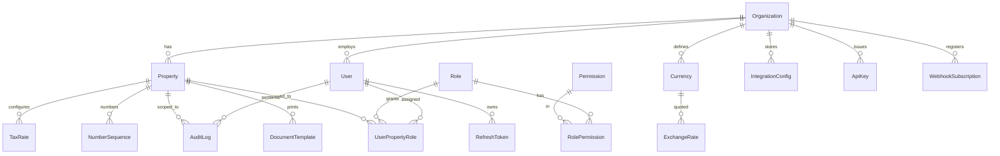
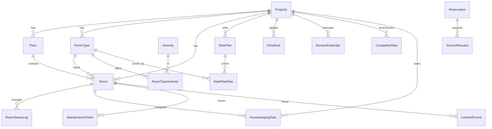
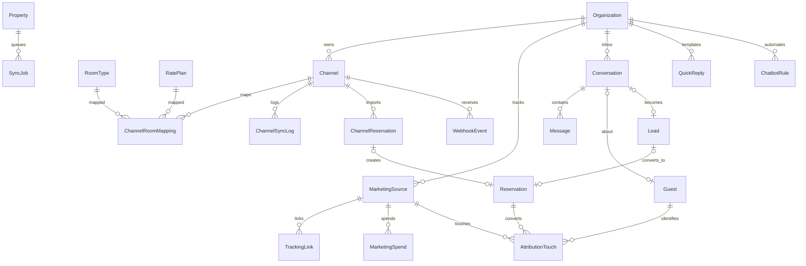
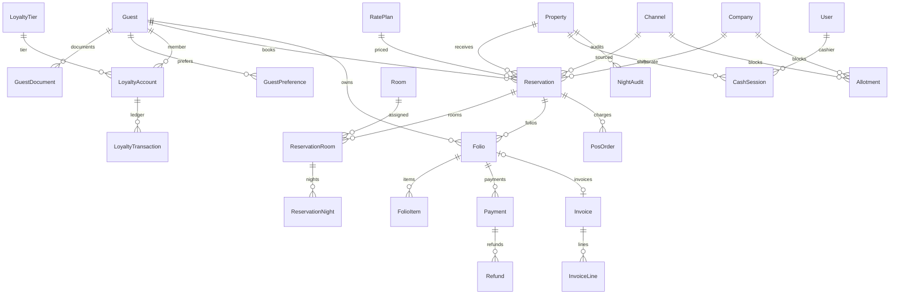
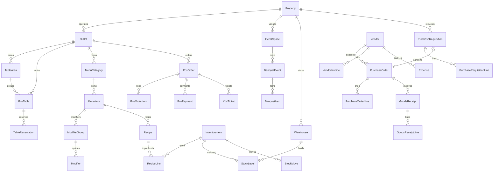
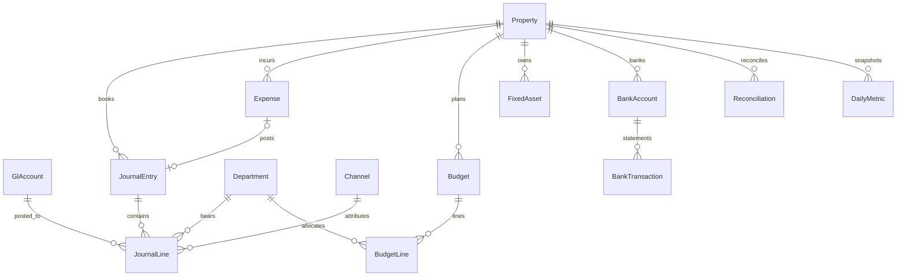
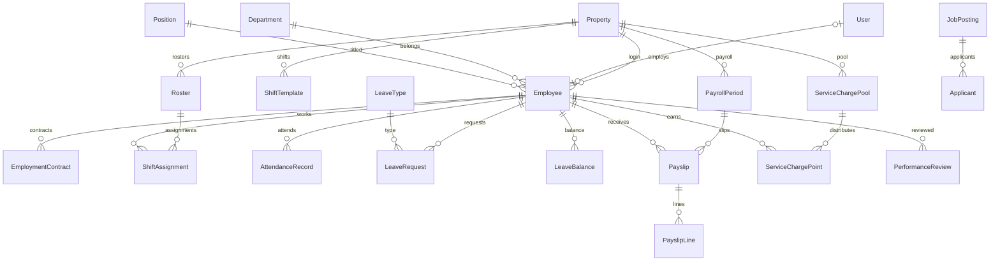
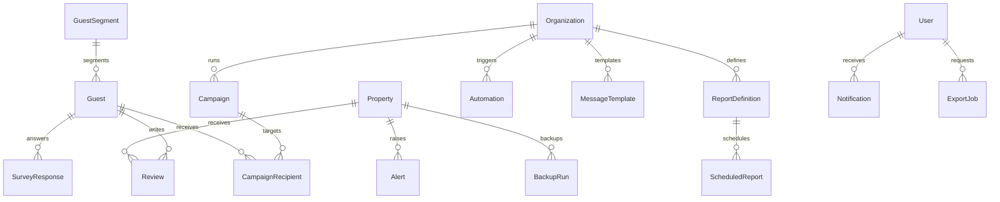

# NINHVANA — Kế hoạch triển khai (Giai đoạn 0)

> Hệ thống Quản trị Doanh nghiệp Khách sạn & Nhà hàng 5 sao — đa cơ sở, đa kênh, tài chính hợp nhất.
> Tài liệu này là **nguồn sự thật duy nhất** cho kiến trúc, mô hình dữ liệu, backlog và tiêu chí nghiệm thu.
> Cập nhật lần cuối: 2026-10-25 · Phiên bản 1.0 · Trạng thái: **đã chốt để thi công**

---

## 0. Tóm tắt điều hành

| Hạng mục | Quyết định |
|---|---|
| Sản phẩm | NinhVaNa — PMS + POS + Channel Manager + Revenue + Cost + HRM + Finance + CRM + BI |
| Mô hình | Modular monolith (NestJS) sẵn sàng tách service; monorepo TypeScript |
| Frontend | Next.js 15 (App Router) + React 19 + Tailwind 3.4 + shadcn-style primitives (Radix) |
| Mobile | **PWA responsive** (quyết định: tiết kiệm 4–6 tuần so với React Native, đáp ứng đủ "dùng trên điện thoại" + offline cơ bản cho POS/Housekeeping). Kiến trúc UI dùng chung, không fork code. |
| Dữ liệu | PostgreSQL 16 + Prisma 6; Redis 7 (lock, cache, BullMQ) |
| Xác thực | JWT access 15' (httpOnly cookie) + refresh 30 ngày (rotation, reuse detection) + TOTP 2FA |
| Tiền tệ | Lưu `Decimal(18,2)` theo tiền tệ gốc của chứng từ + `amountVnd` quy đổi; VND là base |
| Thời gian | `businessDate` theo Asia/Ho_Chi_Minh, cắt ngày 06:00 (cấu hình được) |
| Nguồn sự thật tài chính | **Sổ nhật ký kép (GL)** — mọi KPI/báo cáo đọc từ GL, đảm bảo đối soát bằng 0 |
| Kênh | Adapter/Strategy pattern; **mock connectors chạy thật** cho OTA + social; cắm credential thật qua `IntegrationConfig` (mã hoá AES-256-GCM) |
| Môi trường demo | Docker Compose (chuẩn) **và** script chạy local không cần Docker (máy hiện tại không có Docker) |
| Ngôn ngữ | vi (mặc định) + en; từ điển tĩnh có kiểu, không phụ thuộc dịch vụ ngoài |

**Phạm vi giao trong 7 giai đoạn:** toàn bộ 10 module bắt buộc + 4 tính năng nâng cao (trợ lý AI, dự báo, QR order/thanh toán, thiết kế interface khoá cửa) + PWA + seed 24 tháng + bộ test nghiệm thu.

---

## 1. Phân tích yêu cầu & giả định

### 1.1 Giả định nghiệp vụ (đã chọn phương án hợp lý nhất, không chờ xác nhận)

| # | Giả định | Lý do / tác động |
|---|---|---|
| A1 | Tập đoàn demo: **NinhVaNa Group** gồm `NVN-HAN` (khách sạn 250 phòng, 5★, Hà Nội: 4 nhà hàng/bar, spa, 3 phòng hội nghị) và `NVN-DAN` (nhà hàng cao cấp độc lập Đà Nẵng, 120 chỗ, 1 bar) | Đúng yêu cầu seed; 2 mô hình vận hành khác nhau để chứng minh đa cơ sở |
| A2 | Năm tài chính = năm dương lịch; báo cáo quản trị theo **business date**; kỳ kế toán tháng | Chuẩn USALI & VAS |
| A3 | VAT: 8% (dịch vụ lưu trú/ăn uống theo chính sách giảm thuế) và 10% (hàng hoá/khác) — **cấu hình theo `TaxRate`**, không hardcode; phí dịch vụ F&B 5%, spa 5%, rooms 0% (cấu hình) | Tránh sai lệch khi luật đổi |
| A4 | Giá niêm yết **đã bao gồm** VAT và phí dịch vụ hay **chưa**? → Chọn **chưa bao gồm** (++), thể hiện rõ trên booking engine/POS; có cờ `pricesIncludeTax` theo property để đổi | Thực tế VN: niêm yết ++ tại khách sạn 5★ |
| A5 | Hoa hồng OTA là **chi phí kênh** (USALI: *Commissions* – Undistributed), không giảm doanh thu gộp; dashboard hiển thị thêm **net revenue = gross − commission − payment fee** | Yêu cầu "tách doanh thu thuần/gộp" |
| A6 | Phí lưu trú (lodging fee) mặc định 0, bật theo cấu hình property (một số địa phương áp dụng) | Không có chuẩn quốc gia bắt buộc |
| A7 | Service charge được phân bổ theo **điểm** (hệ số chức danh × giờ công), chia hàng tháng, miễn thuế TNCN phần chia theo quy định nội bộ | Yêu cầu "chia theo điểm" |
| A8 | Lương: BHXH 8% / BHYT 1.5% / BHTN 1% (NLĐ); NSDLĐ 17.5% + 3% + 1% + KPCĐ 2%; trần đóng 20× lương cơ sở (2.34tr → 46.8tr); giảm trừ bản thân 11tr, NPT 4.4tr; thuế TNCN 7 bậc | Tham số hoá trong `PayrollConfig`, hiển thị công thức trên UI |
| A9 | Chấm công: QR động tại điểm danh + GPS geofence (bán kính cấu hình); thiết bị vân tay/khuôn mặt tích hợp qua adapter `AttendanceDeviceProvider` (mock + webhook) | Không thể tích hợp phần cứng thật trong môi trường demo |
| A10 | Thanh toán online: VNPay/MoMo/ZaloPay/Stripe chạy **sandbox adapter** với chữ ký HMAC đầy đủ + chế độ mock; VietQR sinh chuỗi EMVCo + hiển thị QR | Cần merchant credential thật để go-live |
| A11 | Hoá đơn điện tử: adapter `EInvoiceProvider` (VNPT/Viettel/MISA/Mock). Mock ký giả lập, sinh XML/PDF có số hoá đơn; production cần HSM/USB token của nhà cung cấp | Quy định VN |
| A12 | OTA/Social API: **mock connector** mô phỏng đầy đủ pull/push/webhook, retry, DLQ; credential thật nạp qua UI `.env` → `IntegrationConfig` | Không có quyền truy cập API đối tác |
| A13 | Đa tiền tệ: tỷ giá lưu theo ngày, lấy từ `ExchangeRate` (seed + nhập tay + adapter provider); quy đổi tại thời điểm chứng từ | Yêu cầu |
| A14 | "AI" gồm 2 lớp: (a) **rule engine + truy vấn ngôn ngữ tự nhiên xác định** trên kho metric (chạy offline, không cần API key); (b) adapter LLM tuỳ chọn (OpenAI-compatible) nếu cấu hình `LLM_API_KEY` | Không phụ thuộc dịch vụ ngoài để demo |
| A15 | Dự báo nhu cầu: Holt-Winters (mùa vụ tuần + tháng) + pickup curve, thuần TypeScript, backtest trên 24 tháng seed | Không cần Python/ML service |
| A16 | Email/Zalo/SMS: adapter + **MailHog** trong Docker; chế độ mock ghi ra `NotificationOutbox` xem được trên UI | Không gửi thật khi demo |
| A17 | Ảnh/chứng từ: lưu local volume (dev) qua `StorageService`; S3/MinIO adapter cho production | Đơn giản, thay thế được |
| A18 | Backup: `pg_dump` nightly (cron trong compose) + script restore + kiểm tra checksum; RPO 24h, RTO 1h (demo) | Yêu cầu "backup tự động" |
| A19 | Ngôn ngữ mặc định vi; mọi chuỗi UI đi qua từ điển; dữ liệu mẫu dùng tên Việt/Quốc tế thực tế | Yêu cầu |
| A20 | Trình duyệt mục tiêu: Chrome/Edge/Safari bản hiện hành; màn hình 390 / 768 / 1280 / 1920 | Yêu cầu |

### 1.2 Ngoài phạm vi (ghi rõ để không kỳ vọng sai)
- Kết nối API OTA/social **thật** (cần hợp đồng, certification, IP whitelist) → đã có connector + tài liệu cắm key.
- Chữ ký số hoá đơn thật (HSM/token) → adapter + mock ký.
- Khoá cửa IoT thật → interface `LockProvider` + mock + mô phỏng trạng thái; không điều khiển thiết bị.
- OCR CCCD/hộ chiếu/hoá đơn thật → interface + mock trả kết quả suy luận từ ảnh mẫu; nhập tay luôn sẵn.
- Đa quốc gia/đa pháp nhân hợp nhất (consolidation đa entity) → chỉ hợp nhất 2 property trong 1 pháp nhân.
- Mobile native (App Store/Play) → PWA cài được (add-to-home-screen).

---

## 2. Kiến trúc hệ thống

### 2.1 Sơ đồ tổng thể

```
                            ┌──────────────────────────────────────────────┐
                            │            Người dùng (desktop/tablet/mobile) │
                            └───────────────┬──────────────────────────────┘
                                            │ HTTPS
                 ┌──────────────────────────▼───────────────────────────┐
                 │  apps/web — Next.js 15 App Router (PWA, i18n vi/en)   │
                 │  • Server layout theo vai trò   • TanStack Query       │
                 │  • /api/* rewrite → api:4000    • Service Worker       │
                 │  • Recharts, Cmd+K, dark mode, a11y AA                 │
                 └───────────────┬──────────────────────┬───────────────┘
                                 │ REST /api/v1         │ WS /ws (socket.io)
                 ┌───────────────▼──────────────────────▼───────────────┐
                 │  apps/api — NestJS 11 (modular monolith)              │
                 │                                                       │
                 │  ┌───────────── HTTP layer ─────────────┐             │
                 │  │ Guards: JWT → 2FA → RBAC → Property  │             │
                 │  │ Pipes: Zod validation · Interceptors │             │
                 │  │ Filters: problem+json · Throttler    │             │
                 │  └───────────────┬──────────────────────┘             │
                 │  ┌───────────────▼──────────────────────┐             │
                 │  │ Domain modules (controller→service→  │             │
                 │  │ repository/Prisma) 26 modules        │             │
                 │  └───────┬───────────────┬──────────────┘             │
                 │          │ events        │ jobs                       │
                 │  ┌───────▼──────┐  ┌─────▼───────────────┐            │
                 │  │ EventBus +   │  │ QueueService        │            │
                 │  │ Outbox       │  │ BullMQ ⇄ PgDriver   │            │
                 │  └───────┬──────┘  └─────┬───────────────┘            │
                 │          │               │                            │
                 │  ┌───────▼───────────────▼──────────────┐             │
                 │  │ Integrations: OTA/Social/Payment/    │             │
                 │  │ EInvoice/Storage/Mail/OCR/Lock/LLM   │             │
                 │  │ (Adapter pattern, mock-first)        │             │
                 │  └──────────────────────────────────────┘             │
                 └───────┬──────────────┬──────────────┬────────────────┘
                         │              │              │
                  ┌──────▼─────┐ ┌──────▼──────┐ ┌─────▼──────────┐
                  │ PostgreSQL │ │   Redis     │ │ Object storage │
                  │ 16 (GL,    │ │ lock/cache/ │ │ (local / S3)   │
                  │ PMS, POS)  │ │ BullMQ      │ │                │
                  └────────────┘ └─────────────┘ └────────────────┘

  Ngoài hệ thống (adapter, mock mặc định):
  Booking.com · Agoda · Expedia · Airbnb · Traveloka · Trip.com · Google Hotel Ads · Tripadvisor
  Facebook · Instagram · Zalo OA · WhatsApp · TikTok · Telegram · LINE · KakaoTalk · WeChat
  VNPay · MoMo · ZaloPay · Stripe · VietQR · VNPT/Viettel/MISA e-invoice · SMTP/Zalo ZNS/SMS
```

### 2.2 Nguyên tắc thiết kế

1. **GL là nguồn sự thật tài chính.** Mọi doanh thu/chi phí đều sinh bút toán kép cân bằng trong cùng transaction với chứng từ gốc. Dashboard, P&L, báo cáo bộ phận/kênh đều tổng hợp từ `JournalLine`. Vì vậy tiêu chí "Dashboard = bộ phận = kênh = sổ giao dịch" đúng **theo cấu trúc**, không phải do khớp tay.
2. **Property scoping ở tầng dữ liệu.** Mọi bảng vận hành có `propertyId`; mọi query vận hành bắt buộc qua `PropertyScope` (guard + service helper). Vai trò cấp tập đoàn có `orgWide` để xem hợp nhất.
3. **Idempotent mọi nơi có thể lặp.** Webhook, ARI push, payment callback, night audit, posting: khoá idempotency (unique) + trạng thái job.
4. **Chống overbooking 3 lớp.** Redis lock (nhanh, giảm contention) → kiểm tra tồn trong transaction → **PostgreSQL exclusion constraint** trên `(room_id, daterange)` (chân lý cuối, đúng cả khi lock hỏng). Test đồng thời là bằng chứng.
5. **Bất biến & truy vết.** `AuditLog` chỉ ghi, có hash chain (`hashPrev`,`hashSelf`) để phát hiện sửa/xoá; thao tác nhạy cảm bắt buộc `reason`. Không có API update/delete audit.
6. **Hợp đồng kiểu chặt.** Zod schema dùng chung FE/BE (`packages/shared`), suy ra type; DTO không viết tay trùng lặp.
7. **Adapter-first cho tích hợp.** Interface ổn định, mock chạy được offline, cùng một luồng nghiệp vụ cho mock và thật.
8. **Hiệu năng có chủ đích.** Snapshot ngày (`DailyMetric`) + index tổng hợp + cache 30s cho dashboard; job rebuild snapshot sau night audit; đo p95 bằng script autocannon.

### 2.3 Luồng dữ liệu doanh thu (bắt buộc hiểu để đọc code)

```
Đặt phòng ─┐
POS order ─┼─► FolioItem (CHARGE, department, channel, tax, service charge)
Spa/Event ─┘            │
                        ▼  (ghi nhận doanh thu theo ngày nghiệp vụ, khi Night Audit hoặc khi thanh toán)
             PostingService (shared/accounting/posting.ts)
                        │  sinh bút toán kép
                        ▼
          JournalEntry ──► JournalLine { accountCode, department, channelId, debit, credit }
                        │
        ┌───────────────┼────────────────┬──────────────────┐
        ▼               ▼                ▼                  ▼
   P&L / GOP       Dashboard KPI    Báo cáo kênh       Trial balance
   (USALI)         (doanh thu, ADR,  (gross/net/ROI)    / Bảng cân đối
                    RevPAR, GOPPAR)
```
Thanh toán → `Payment` (method) → bút toán Dr Cash/Bank/Gateway clearing, Cr AR.
Night Audit → post doanh thu phòng chưa ghi nhận + khoá sổ + đối soát quỹ + snapshot + báo cáo.

### 2.4 Mô hình sự kiện nội bộ

| Event | Phát khi | Consumer |
|---|---|---|
| `reservation.created/updated/cancelled` | đặt/sửa/huỷ (kể cả từ kênh) | ARI push, dashboard cache, notification, attribution |
| `reservation.checked_in` / `checked_out` | front office | housekeeping, folio, loyalty |
| `folio.charge_posted` / `folio.settled` | folio | revenue, invoice, channel commission |
| `pos.order.created/sent/paid/voided` | POS/KDS | kitchen, inventory (recipe), revenue |
| `housekeeping.task.updated` | mobile HK | front desk, WS |
| `payment.succeeded/refunded` | gateway callback | folio, notification |
| `expense.approved/paid` | cost | GL, budget alert |
| `payroll.calculated/approved` | HRM | GL, payslip notification |
| `night_audit.completed` | audit | snapshot rebuild, scheduled reports, alerts |
| `channel.sync.failed` | ARI | DLQ, integration monitor, alert |

Cơ chế: `EventBus` (in-process, `@nestjs/event-emitter`) + **Outbox** (`DomainEvent` table) cho job bất đồng bộ; BullMQ consumer đọc outbox khi `REDIS_URL` có, nếu không dùng worker polling Postgres (cùng interface).

---

## 3. Mô hình dữ liệu (ERD)

### 3.1 Quy ước
- Khoá chính `cuid()`; mọi bảng vận hành có `propertyId` (trừ bảng cấp tổ chức).
- Tiền: `Decimal(18,2)`, số lượng `Decimal(12,3)`; mọi chứng từ lưu `currency`, `fxRate`, `amountVnd`.
- Soft-delete chỉ dùng cho danh mục (`isActive`); chứng từ tài chính **không xoá** (void/reversal).
- Thời gian: `timestamptz`; `businessDate` kiểu `date`.
- Khoá nghiệp vụ: `@@unique([propertyId, code])` hoặc `@@unique([...])` theo chứng từ.

### 3.2 ERD theo miền

**A. Tổ chức, danh tính, cấu hình**


**B. Phòng, giá, tồn**


**C. Kênh bán & phân phối**


**D. Khách, đặt phòng, folio, thanh toán**


**E. POS, sự kiện, kho, mua hàng**


**F. Tài chính, chi phí, ngân sách**


**G. Nhân sự & lương**


**H. CRM, đánh giá, báo cáo, vận hành**


### 3.3 Danh mục bảng (đầy đủ, 147 model)

<details>
<summary>Nhóm A — Tổ chức & cấu hình (17)</summary>

`Organization` `Property` `User` `Role` `Permission` `RolePermission` `UserPropertyRole` `RefreshToken` `AuditLog` `SystemSetting` `NumberSequence` `Currency` `ExchangeRate` `TaxRate` `DocumentTemplate` `IntegrationConfig` `ApiKey` `WebhookSubscription` `DomainEvent` `Notification` `Alert` `BackupRun` `HealthCheckRun`
</details>

<details>
<summary>Nhóm B — Phòng & giá (11)</summary>

`Floor` `RoomType` `Amenity` `RoomTypeAmenity` `Room` `RoomStatusLog` `RatePlan` `RatePlanRate` `PriceRule` `DemandCalendar` `CompetitorRate`
</details>

<details>
<summary>Nhóm C — Kênh & marketing (11)</summary>

`Channel` `ChannelRoomMapping` `ChannelSyncLog` `ChannelReservation` `WebhookEvent` `SyncJob` `MarketingSource` `TrackingLink` `MarketingSpend` `AttributionTouch` `Conversation` `Message` `QuickReply` `ChatbotRule` `Lead`
</details>

<details>
<summary>Nhóm D — Khách & lưu trú (23)</summary>

`Guest` `GuestDocument` `GuestPreference` `GuestTag` `GuestTagLink` `GuestSegment` `LoyaltyTier` `LoyaltyAccount` `LoyaltyTransaction` `Company` `Reservation` `ReservationRoom` `ReservationNight` `ReservationGuest` `Allotment` `Folio` `FolioItem` `Payment` `Refund` `Invoice` `InvoiceLine` `CashSession` `NightAudit` `HousekeepingTask` `MaintenanceTicket` `LostAndFound` `ServiceRequest`
</details>

<details>
<summary>Nhóm E — POS & sự kiện (18)</summary>

`Outlet` `TableArea` `PosTable` `TableReservation` `MenuCategory` `MenuItem` `ModifierGroup` `Modifier` `Recipe` `RecipeLine` `PosOrder` `PosOrderItem` `PosPayment` `KdsTicket` `EventSpace` `BanquetEvent` `BanquetItem` `ShiftHandover` (POS ca)
</details>

<details>
<summary>Nhóm F — Kho, mua hàng, chi phí (18)</summary>

`Warehouse` `InventoryItem` `StockLevel` `StockMove` `StockCount` `StockCountLine` `Vendor` `PurchaseRequisition` `PurchaseRequisitionLine` `PurchaseOrder` `PurchaseOrderLine` `GoodsReceipt` `GoodsReceiptLine` `VendorInvoice` `Expense` `ExpenseApproval` `Budget` `BudgetLine` `FixedAsset`
</details>

<details>
<summary>Nhóm G — Kế toán (10)</summary>

`GlAccount` `Department` `JournalEntry` `JournalLine` `BankAccount` `BankTransaction` `Reconciliation` `DailyMetric` `AccountingPeriod` `TaxFiling`
</details>

<details>
<summary>Nhóm H — Nhân sự (18)</summary>

`Employee` `EmploymentContract` `Position` `ShiftTemplate` `Roster` `ShiftAssignment` `AttendanceRecord` `AttendanceDevice` `LeaveType` `LeaveRequest` `LeaveBalance` `PayrollPeriod` `Payslip` `PayslipLine` `ServiceChargePool` `ServiceChargePoint` `PerformanceReview` `JobPosting` `Applicant` `TrainingCourse` `TrainingRecord`
</details>

<details>
<summary>Nhóm I — CRM & báo cáo (12)</summary>

`Review` `SurveyResponse` `Campaign` `CampaignRecipient` `Automation` `MessageTemplate` `ReportDefinition` `ScheduledReport` `ExportJob` `SavedView` `NotificationPreference` `AuditRetention`
</details>

> Tổng: **147 model**. Prisma schema dự kiến ~1.900 dòng; migration chia 4 bước (nền tảng → lưu trú → vận hành → tài chính/HR/CRM) để dễ rollback.

### 3.4 Ràng buộc quan trọng (viết bằng SQL migration thủ công)

| # | Ràng buộc | Mục đích |
|---|---|---|
| C1 | `EXCLUDE USING gist (room_id WITH =, daterange(check_in, check_out, '[)') WITH &&) WHERE (status IN ('RESERVED','IN_HOUSE'))` trên `ReservationRoom` | **Chặn overbooking tuyệt đối ở tầng DB** |
| C2 | `UNIQUE (channel_id, external_id)` trên `ChannelReservation`; `UNIQUE (channel_id, idempotency_key)` trên `WebhookEvent` | Chống trùng đặt phòng/webhook |
| C3 | `UNIQUE (property_id, business_date)` trên `NightAudit` | Một lần chốt/ngày/cơ sở |
| C4 | `CHECK (quantity > 0)`, `CHECK (debit >= 0 AND credit >= 0)`, `CHECK ((debit>0) <> (credit>0))` trên JournalLine | Bút toán hợp lệ |
| C5 | `UNIQUE (reservation_id, business_date)` trên `ReservationNight` | Không post 2 lần tiền phòng |
| C6 | `UNIQUE (warehouse_id, item_id)` StockLevel; `UNIQUE (payroll_period_id, employee_id)` Payslip | Toàn vẹn |
| C7 | Trigger `audit_no_update` (chặn UPDATE/DELETE trên AuditLog) | Bất biến audit |
| C8 | `UNIQUE (code)` trên GlAccount theo org; `CHECK (usali_code IS NOT NULL OR vas_code IS NOT NULL)` | Ánh xạ USALI/VAS |
| C9 | Index: `(property_id, business_date)` trên JournalLine, FolioItem, PosOrder, Expense, DailyMetric | p95 < 300ms |
| C10 | `UNIQUE (marketing_source_id, slug)` TrackingLink; `UNIQUE (provider, external_id)` Review | Attribution không trùng |

### 3.5 Bảng ánh xạ USALI ↔ VAS (trích, đầy đủ trong seed)

| USALI | Tên | VAS/TT200 | Loại |
|---|---|---|---|
| 1000 | Rooms Revenue | 5111 | REVENUE |
| 2000 | Food Revenue | 5112 | REVENUE |
| 2100 | Beverage Revenue | 5112 | REVENUE |
| 3000 | Other Operated Departments (Spa) | 5113 | REVENUE |
| 4000 | Miscellaneous Income | 5118 | REVENUE |
| 5000 | Rooms Expense | 6321 | EXPENSE |
| 6000 | F&B Cost of Sales | 6322 | EXPENSE |
| 6100 | Payroll & Related | 6221 | EXPENSE |
| 6200 | Utilities | 6271 | EXPENSE |
| 6300 | Sales & Marketing | 6411 | EXPENSE |
| 6400 | Property Operations & Maintenance | 6272 | EXPENSE |
| 6500 | Administrative & General | 6421 | EXPENSE |
| 6600 | Commissions (OTA) | 6417 | EXPENSE |
| 7000 | Depreciation | 6274 | EXPENSE |
| 8000 | Rent, Insurance, Property Tax | 6273 | EXPENSE |
| 1310 | Accounts Receivable | 131 | ASSET |
| 1110 | Cash on Hand | 111 | ASSET |
| 1120 | Bank | 112 | ASSET |
| 2140 | VAT Payable | 3331 | LIABILITY |
| 3340 | Payroll Payable | 334 | LIABILITY |
| 3310 | Accounts Payable | 331 | LIABILITY |
| 4110 | Owner's Equity | 411 | EQUITY |

---

## 4. Cấu trúc thư mục

```
grand-suite/
├── apps/
│   ├── api/                          # NestJS 11 — modular monolith
│   │   ├── src/
│   │   │   ├── main.ts               # bootstrap, helmet, cookie, swagger, versioning
│   │   │   ├── app.module.ts
│   │   │   ├── common/               # cross-cutting
│   │   │   │   ├── auth/             # jwt.strategy, guard, refresh, 2FA, csrf, decorators
│   │   │   │   ├── rbac/             # permissions map, role guards, property scope
│   │   │   │   ├── prisma/           # PrismaService, soft-delete, tx helper
│   │   │   │   ├── money/            # Decimal helpers, fx
│   │   │   │   ├── events/           # EventBus, outbox, domain-event service
│   │   │   │   ├── queue/            # QueueService (BullMQ | Pg), decorators
│   │   │   │   ├── cache/            # CacheService, lock/redis-lock
│   │   │   │   ├── crypto/           # AES-GCM field encryption, hashing, HMAC
│   │   │   │   ├── http/             # interceptors, filters, problem+json, pagination
│   │   │   │   ├── audit/            # audit interceptor + decorator @Audit
│   │   │   │   ├── storage/          # local/S3
│   │   │   │   └── util/             # business-date, sequence, csv
│   │   │   ├── modules/
│   │   │   │   ├── auth/  iam/  properties/  settings/
│   │   │   │   ├── guests/  reservations/  front-office/  housekeeping/
│   │   │   │   ├── folios/  payments/  invoices/  night-audit/
│   │   │   │   ├── pos/  kitchen/  banquet/  spa/
│   │   │   │   ├── channels/         # + connectors/{booking,agoda,expedia,airbnb,traveloka,trip,google,tripadvisor,mock}
│   │   │   │   ├── booking-engine/   # public availability/quote/book, QR/UTM
│   │   │   │   ├── social/           # unified inbox + connectors/{facebook,instagram,zalo,whatsapp,tiktok,telegram,line,kakaotalk,wechat}
│   │   │   │   ├── marketing/        # attribution, ROI, CAC
│   │   │   │   ├── revenue/          # pricing rules, forecast, competitor, allotment
│   │   │   │   ├── inventory/  purchasing/  costs/  budgets/
│   │   │   │   ├── accounting/       # chart, posting, P&L, GL, tax, AR/AP, cash flow
│   │   │   │   ├── hr/               # employees, roster, attendance, leave
│   │   │   │   ├── payroll/          # calc, service charge, payslips
│   │   │   │   ├── crm/  campaigns/  reviews/  loyalty/
│   │   │   │   ├── dashboard/        # KPI, alerts, assistant
│   │   │   │   ├── reports/          # builder, export, scheduled
│   │   │   │   ├── notifications/  integrations/  admin/  health/
│   │   │   │   └── realtime/         # socket.io gateway
│   │   │   ├── jobs/                 # processors (ARI, poll, snapshot, reports, alerts)
│   │   │   └── database/             # prisma seed helpers, fixtures
│   │   ├── test/                     # integration + e2e-ish api tests
│   │   └── prisma/                   # schema.prisma, migrations/, sql constraints
│   └── web/                          # Next.js 15
│       ├── src/app/
│       │   ├── (auth)/login, 2fa, forgot
│       │   ├── (app)/                # shell: sidebar, topbar, Cmd+K, WS toasts
│       │   │   ├── dashboard/
│       │   │   ├── front-desk/  tape-chart/  reservations/  guests/
│       │   │   ├── folios/[id]/  cashier/
│       │   │   ├── pos/  pos/kds/  banquet/
│       │   │   ├── housekeeping/  maintenance/
│       │   │   ├── channels/  channels/sync-log/  inbox/  booking-engine/
│       │   │   ├── revenue/  night-audit/
│       │   │   ├── costs/  purchasing/  inventory/  budgets/
│       │   │   ├── hr/  payroll/  roster/
│       │   │   ├── finance/{pnl,balance,cashflow,ar,ap,tax}/
│       │   │   ├── crm/{guests,segment,campaigns,reviews,loyalty}/
│       │   │   ├── reports/  reports/builder/
│       │   │   ├── admin/{users,roles,properties,settings,audit,integrations}/
│       │   │   └── assistant/
│       │   ├── booking/              # booking engine công khai + payment return
│       │   └── api/                  # BFF route handlers (auth refresh, export stream)
│       ├── src/components/{ui,charts,layout,domain}/
│       ├── src/lib/{api,i18n,format,auth,ws,offline-queue}/
│       ├── public/{manifest.webmanifest,sw.js,icons,images}/
│       └── e2e/                      # Playwright
├── packages/
│   ├── db/                           # Prisma schema + client wrapper + seed (largest)
│   ├── shared/                       # zod schemas, pure business logic, i18n keys, constants
│   │   └── src/{money,tax,pricing,payroll,posting,night-audit,kpi,forecast,attribution,emvco,dates,types}/
│   ├── ui/                           # design tokens + primitives (Button, Card, Table, Dialog…)
│   ├── config/                       # eslint, tsconfig, tailwind preset
│   └── testing/                      # factories, db test harness
├── docker/                           # Dockerfiles api/web, nginx.conf, backup.sh
├── docs/                             # PLAN, PROGRESS, ARCHITECTURE, ERD, API, SECURITY, CHANNELS, DEMO
├── scripts/                          # dev-db.sh, seed, backup, restore, perf, check-acceptance
├── .github/workflows/ci.yml
├── docker-compose.yml
├── turbo.json  pnpm-workspace.yaml  package.json  .env.example  README.md
```

---

## 5. RBAC — ma trận vai trò & quyền

| Vai trò | Mã | Phạm vi | Quyền chính |
|---|---|---|---|
| Chủ tịch | `CHAIRMAN` | Org | Xem toàn bộ báo cáo, tài chính, audit; không sửa giao dịch |
| Tổng giám đốc | `CEO` | Org | Toàn quyền vận hành & tài chính, phê duyệt ngân sách/CAPEX, cấu hình giá |
| Giám đốc khách sạn | `PROPERTY_MANAGER` | Property | Vận hành cơ sở, duyệt chi ≤ hạn mức, xem P&L cơ sở |
| Kế toán trưởng | `CFO` | Org | Duyệt chi, khoá sổ, thuế, lương, ngân sách, audit |
| Giám đốc doanh thu | `REVENUE_DIRECTOR` | Org/Property | Giá, hạn mức, kênh, forecast, competitor |
| Lễ tân | `FRONT_DESK` | Property | Đặt phòng, check-in/out, folio, thanh toán, HK request |
| Buồng phòng | `HOUSEKEEPING` | Property | Task HK, trạng thái phòng, minibar, lost&found (mobile) |
| Bếp trưởng | `EXEC_CHEF` | Property | Menu, recipe, KDS, yêu cầu mua, kiểm kê bếp |
| Quản lý nhà hàng | `FNB_MANAGER` | Property | POS, bàn, menu, order, BEO, duyệt void/comp |
| Thu ngân | `CASHIER` | Property | POS payment, ca quỹ, hoá đơn, hoàn tiền ≤ hạn mức |
| Nhân sự | `HR_MANAGER` | Org/Property | Nhân viên, ca, chấm công, nghỉ phép, lương (không duyệt chi) |
| Kho | `WAREHOUSE` | Property | Nhập/xuất/chuyển/kiểm kê, PR, nhận hàng |
| Marketing/Sales | `MARKETING` | Org | Inbox, lead, campaign, attribution, chi phí marketing |
| Quản trị hệ thống | `SUPER_ADMIN` | Org | Người dùng, vai trò, tích hợp, backup, cấu hình |

Quyền dạng `resource:action` (`reservation:create`, `folio:void`, `rate:update`, `payroll:approve`, `report:view_org`, `audit:view`, `settings:update`, `expense:approve`…). Ánh xạ vai trò→quyền khai báo **một chỗ** trong `packages/shared/src/rbac.ts` (dùng cho cả FE ẩn/hiện và BE guard) — tránh lệch quyền giữa 2 phía.
Quy tắc bổ sung:
- Duyệt chi theo hạn mức: < 5tr quản lý cơ sở; 5–50tr CFO; > 50tr CEO; > 500tr Chủ tịch.
- Hoàn tiền > 10tr cần CFO duyệt (workflow `ApprovalRequest`).
- Sửa giá/ huỷ hoá đơn/ sửa lương → bắt buộc nhập lý do → ghi AuditLog.

**Tài khoản demo (mật khẩu chung `NinhVaNa@2026`, 2FA tắt cho demo, có 1 tài khoản bật 2FA để test):**
`chairman@ninhvana.vn`, `ceo@ninhvana.vn`, `cfo@ninhvana.vn`, `revenue@ninhvana.vn`, `manager.hanoi@ninhvana.vn`, `frontdesk@ninhvana.vn`, `housekeeping@ninhvana.vn`, `chef@ninhvana.vn`, `fnb@ninhvana.vn`, `cashier@ninhvana.vn`, `hr@ninhvana.vn`, `warehouse@ninhvana.vn`, `marketing@ninhvana.vn`, `admin@ninhvana.vn`.

---

## 6. Backlog ưu tiên (theo giai đoạn)

Ưu tiên: **P0** = bắt buộc cho tiêu chí nghiệm thu; **P1** = bắt buộc theo đặc tả module; **P2** = hoàn thiện/nâng cao.
Ước lượng: S ≤ 0,5 ngày; M ≤ 1,5 ngày; L ≤ 3 ngày (quy đổi agent-round).

### Giai đoạn 0 — Kế hoạch (hoàn tất)
| ID | Việc | P | Est |
|---|---|---|---|
| P0-00 | PLAN.md: giả định, kiến trúc, ERD, backlog, tiêu chí | P0 | M |

### Giai đoạn 1 — Nền tảng
| ID | Việc | P | Est |
|---|---|---|---|
| F1-01 | Monorepo pnpm + Turborepo + tsconfig strict + eslint/prettier + husky/lint-staged | P0 | M |
| F1-02 | Docker Compose: postgres, redis, api, web, mailhog, minio, backup; Dockerfiles multi-stage | P0 | M |
| F1-03 | Script dev local (không Docker): cluster PG `.dev/pgdata` port 55432, redis 56379, tạo DB, migrate, reset | P0 | S |
| F1-04 | Prisma schema giai đoạn nền (org, property, user, role, permission, audit, settings, currency, tax, sequence, integration, api key, webhook, events) + migration + constraints C7 | P0 | L |
| F1-05 | Auth: login, refresh rotation, logout, me, 2FA TOTP setup/verify, password policy, argon2, cookie + CSRF | P0 | L |
| F1-06 | RBAC: permission map, guards, property scope, `@RequirePermission`, seed role/permission | P0 | M |
| F1-07 | Audit log interceptor + hash chain + endpoint truy vấn (chỉ đọc) | P0 | M |
| F1-08 | Design system: tokens sáng/tối (ivory/champagne), typography serif/sans, 24 primitives a11y, layout shell responsive, sidebar theo vai trò | P0 | L |
| F1-09 | i18n vi/en, format tiền/ngày/số, theme toggle, Cmd+K khung, toast, skeleton, empty state | P0 | M |
| F1-10 | Seed nền: 2 property, 13 users, roles, 250+ phòng, 8 outlet, chart of accounts USALI/VAS, tax, currency, exchange rate 24 tháng | P0 | L |
| F1-11 | Health check, structured logging (pino), request id, problem+json, rate limit, helmet | P0 | S |
| F1-12 | CI: lint → typecheck → unit → integration (PG+Redis service) → build | P0 | M |
| **Gate 1** | `pnpm build && pnpm lint && pnpm test` xanh; đăng nhập 13 vai trò; layout đúng vai trò; audit ghi nhận login | | |

### Giai đoạn 2 — Lõi nghiệp vụ (PMS + POS + Revenue)
| ID | Việc | P | Est |
|---|---|---|---|
| F2-01 | Room types/rooms/amenities/floors CRUD + sơ đồ tầng | P0 | M |
| F2-02 | Rate plans, RatePlanRate theo ngày, giá theo kênh, chính sách huỷ/cọc | P0 | L |
| F2-03 | Reservation create (cá nhân/đoàn), availability search, quote server-side (giá + thuế + phí + cọc) | P0 | L |
| F2-04 | **Chống overbooking**: Redis lock + tx + exclusion constraint + test đồng thời 20 request | P0 | M |
| F2-05 | Tape chart Gantt kéo-thả (đổi phòng, đổi ngày, resize), màu theo trạng thái/kênh | P0 | L |
| F2-06 | Check-in/out, đổi phòng, nâng hạng, early/late, no-show, khai báo tạm trú, hồ sơ khách + giấy tờ mã hoá | P0 | L |
| F2-07 | Folio: nhiều folio, tách/chuyển item, void có lý do, in folio | P0 | L |
| F2-08 | Payment: tiền mặt/thẻ/chuyển khoản/VietQR/VNPay/MoMo/ZaloPay/Stripe (adapter+mock callback), refund, đa tiền tệ | P0 | L |
| F2-09 | Invoice + e-invoice adapter (mock) + mẫu in | P0 | M |
| F2-10 | Night Audit: post tiền phòng, chốt doanh thu, đối soát theo phương thức, khoá sổ, báo cáo kiểm toán đêm | P0 | L |
| F2-11 | Housekeeping mobile: task list, checklist, trạng thái phòng, minibar, lost&found, maintenance ticket, offline queue | P0 | L |
| F2-12 | POS: outlet, menu đa cấp, modifier, combo, happy hour, sơ đồ bàn kéo-thả, gộp/tách bàn, order tablet | P0 | L |
| F2-13 | KDS theo trạm, đếm giờ, trạng thái món, gửi bếp realtime | P0 | M |
| F2-14 | Charge to room → folio; tách hoá đơn; tip/voucher/thẻ thành viên; QR order tại bàn | P1 | L |
| F2-15 | Recipe costing + trừ kho tự động + food cost thực tế/lý thuyết + hao hụt | P1 | L |
| F2-16 | Banquet/BEO: báo giá, hợp đồng, lịch phòng, thanh toán theo đợt | P1 | L |
| F2-17 | Concierge/service request, wake-up, airport transfer | P1 | M |
| F2-18 | **Revenue posting engine** (shared) + GL bút toán kép + đối soát | P0 | L |
| F2-19 | WS realtime: booking mới, order mới, task HK, KDS, alert | P0 | M |
| **Gate 2** | Luồng trọn vẹn booking→checkin→POS→folio→checkout→invoice→night audit; test đồng thời; đối soát = 0 | | |

### Giai đoạn 3 — Kênh bán
| ID | Việc | P | Est |
|---|---|---|---|
| F3-01 | Interface connector + registry + base mock + `IntegrationConfig` mã hoá + UI cấu hình | P0 | M |
| F3-02 | OTA mock connectors (8) + simulator sinh booking/webhook + idempotency | P0 | L |
| F3-03 | ARI push job: availability/rate/inventory, retry backoff, DLQ, sync log UI | P0 | L |
| F3-04 | Pull/sync đặt phòng, sửa/huỷ từ kênh, map trạng thái, lỗi hiển thị | P0 | L |
| F3-05 | Booking engine công khai `/booking`: tìm phòng, chọn gói, UTM/tracking link, QR, thanh toán, xác nhận | P0 | L |
| F3-06 | Social inbox hợp nhất: 5 connector thật-mock (FB, IG, Zalo, WhatsApp, TikTok) + 4 adapter design; gán việc, quick reply, tag | P0 | L |
| F3-07 | Chatbot rule + AI gợi ý trả lời/báo giá, handoff người thật | P1 | L |
| F3-08 | Lead → 1-click booking/table reservation; conversion tracking | P0 | M |
| F3-09 | Attribution: UTM, mã KOL/affiliate, tracking link, QR, ROI/CAC/conversion theo kênh | P0 | L |
| F3-10 | Hoa hồng OTA + phí cổng → net revenue theo kênh (bút toán + dashboard) | P0 | M |
| **Gate 3** | ≥5 kênh tạo booking (2 OTA mock, 2 social mock, walk-in) → doanh thu đúng kênh trên dashboard trong ≤2s | | |

### Giai đoạn 4 — Chi phí, Nhân sự, Tài chính
| ID | Việc | P | Est |
|---|---|---|---|
| F4-01 | Chart of accounts + department mapping + posting rules đầy đủ | P0 | M |
| F4-02 | Expense CRUD + danh mục + phê duyệt nhiều cấp + chứng từ + OCR mock | P0 | L |
| F4-03 | PR→PO→GRN→VendorInvoice→Payment, hạn mức duyệt, công nợ AP | P1 | L |
| F4-04 | Kho nhiều kho, nhập/xuất/chuyển/kiểm kê, FIFO/bình quân, hạn dùng, min stock, barcode | P1 | L |
| F4-05 | Budget theo tháng/bộ phận + so sánh thực tế + cảnh báo vượt | P0 | M |
| F4-06 | Employee/contract/department/position CRUD + portal | P1 | L |
| F4-07 | Roster kéo-thả + shift template + đổi ca + publish | P1 | L |
| F4-08 | Attendance QR/GPS + biometric adapter + tính công/OT/đi muộn | P1 | L |
| F4-09 | Payroll engine: gross→net, BHXH/BHYT/BHTN, PIT 7 bậc, OT, service charge, payslip PDF, file ngân hàng | P0 | L |
| F4-10 | P&L USALI theo bộ phận + hợp nhất, GOP/GOPPAR/TRevPAR | P0 | M |
| F4-11 | Bảng cân đối, dòng tiền, AR/AP aging, thuế | P1 | L |
| F4-12 | Đối soát ngân hàng/cổng/kênh/sổ + xuất MISA/Fast/SAP | P1 | M |
| **Gate 4** | Chi phí + lương seed/nhập → P&L, GOP, GOPPAR đúng công thức (test đối chiếu số học) | | |

### Giai đoạn 5 — Dashboard & Báo cáo
| ID | Việc | P | Est |
|---|---|---|---|
| F5-01 | Executive dashboard: 12 KPI realtime, so sánh kỳ trước/budget, filter cơ sở/thời gian/kênh/bộ phận | P0 | L |
| F5-02 | Biểu đồ: doanh thu theo bộ phận/kênh/quốc tịch/hạng phòng, phễu, heatmap 12 tháng | P0 | L |
| F5-03 | Cảnh báo thông minh (6 loại) + rule engine + WS + ack | P0 | M |
| F5-04 | Report builder kéo-thả (dataset/dimension/metric/filter/chart) + lưu/chia sẻ | P1 | L |
| F5-05 | Export Excel/PDF/CSV server-side + lịch gửi email/Zalo + log | P0 | L |
| F5-06 | Trợ lý AI: NL query trên metric, tóm tắt ngày/tuần, phát hiện bất thường, optional LLM | P1 | L |
| F5-07 | Dự báo 90 ngày (Holt-Winters + pickup), gợi ý giá, so sánh đối thủ | P1 | L |
| **Gate 5** | Dashboard <2s với seed 24 tháng; số liệu khớp 3 chiều; export mở được | | |

### Giai đoạn 6 — Hoàn thiện
| ID | Việc | P | Est |
|---|---|---|---|
| F6-01 | Unit test ≥70% logic lõi (money/tax/pricing/payroll/posting/KPI/forecast) | P0 | L |
| F6-02 | Integration test: overbooking đồng thời, idempotency, night audit, reconciliation, P&L | P0 | L |
| F6-03 | Playwright 5 luồng + mobile viewport | P0 | L |
| F6-04 | Bảo mật: OWASP checklist, rate limit, CSRF, XSS, header, dependency audit, secret scan | P0 | M |
| F6-05 | Hiệu năng: index, cache, snapshot, autocannon p95 + dashboard TTI | P0 | M |
| F6-06 | Tài liệu: README, ARCHITECTURE, ERD, API, CHANNELS, SECURITY, DEPLOYMENT, DEMO | P0 | L |
| F6-07 | Backup/restore script + kiểm thử khôi phục + màn hình admin | P1 | M |
| F6-08 | PWA offline (POS/HK) + cài đặt + sync | P1 | M |
| F6-09 | Kịch bản demo + dữ liệu demo + video script | P1 | S |
| **Gate 6** | 8/8 tiêu chí nghiệm thu có bằng chứng tự động | | |

---

## 7. Chiến lược kiểm thử & nghiệm thu

### 7.1 Tầng test
| Tầng | Công cụ | Phạm vi | Ngưỡng |
|---|---|---|---|
| Unit | Vitest | `packages/shared` (money, tax, pricing, posting, payroll, KPI, forecast, attribution, EMVCo), service thuần | ≥70% statements/branches trên logic lõi; 100% nhánh công thức tài chính |
| Integration | Vitest + real PG/Redis | reservation, overbooking đồng thời, channel idempotency, night audit, posting cân bằng, P&L, payroll, RBAC | Tất cả test P0 xanh |
| Contract | zod schema + supertest | response shape các endpoint chính | 100% endpoint có schema |
| E2E | Playwright (chromium + mobile) | 5 luồng + responsive 1920/768/390 | 5/5 xanh |
| Load | autocannon script | tìm phòng, dashboard, tạo booking | p95 API < 300ms; dashboard < 2s |
| Security | eslint-plugin-security, `pnpm audit`, custom checklist, ZAP baseline (nếu có) | OWASP Top 10 | 0 lỗi critical/high |

### 7.2 Ma trận tiêu chí nghiệm thu → bằng chứng

| # | Tiêu chí | Bằng chứng tự động | Cách demo |
|---|---|---|---|
| 1 | `docker compose up` + đăng nhập 13 vai trò | `scripts/check-acceptance.sh` → health + login all roles; CI job compose | `docker compose up -d` rồi mở 3000 |
| 2 | ≥5 kênh → dashboard đúng kênh | `test/acceptance/channels.e2e-spec.ts` + Playwright `channels.spec.ts` | Bấm "Simulate OTA booking" 5 kênh, xem dashboard |
| 3 | Không overbooking kể cả đồng thời | `reservation.concurrency.spec.ts` (20 song song, 1 thắng) + test DB constraint | Chạy test, xem log constraint |
| 4 | Luồng trọn vẹn tới P&L | `flow.full-stay.spec.ts` + Playwright `full-flow.spec.ts` | Kịch bản demo 12 bước |
| 5 | Số liệu khớp 3 chiều | `reconciliation.spec.ts` (dashboard = dept = channel = GL = folio) | Màn hình "Đối soát" hiển thị 0 lệch |
| 6 | Chi phí + lương → P&L/GOP/GOPPAR | `pnl.formulas.spec.ts` (tính tay độc lập) | Nhập lương kỳ, chạy P&L |
| 7 | Responsive 1920/768/390 | Playwright 3 viewport, ảnh chụp lưu `docs/evidence/` | Resize trình duyệt |
| 8 | Coverage ≥70% + e2e + bảo mật | `pnpm test:coverage`, `pnpm e2e`, `pnpm audit`, checklist | Báo cáo coverage trong CI |

### 7.3 Định nghĩa "Done" cho mỗi giai đoạn
1. Build + lint + typecheck + test xanh (không skip test P0).
2. Không còn TODO ở tính năng cốt lõi; mọi nút bấm có hành vi thật.
3. `docs/PROGRESS.md` cập nhật: đã làm / chưa làm / rủi ro / số liệu test.
4. Dữ liệu demo chạy được bằng một lệnh.
5. Truy cập UI ở 3 kích thước không vỡ layout.

---

## 8. Môi trường & triển khai

### 8.1 Đường chuẩn — Docker Compose
`postgres:16-alpine`, `redis:7-alpine`, `api` (Node 24 alpine, multi-stage), `web` (Next standalone), `worker` (cùng image api, vai trò worker), `mailhog`, `minio`, `backup` (cron pg_dump). Healthcheck + depends_on + volume. Một lệnh: `docker compose up -d --build` → migrate + seed tự động (entrypoint idempotent).

### 8.2 Đường local (máy hiện tại **không có Docker**)
`scripts/dev-db.sh start` → `initdb` cluster tại `.dev/pgdata`, chạy port **55432**, tạo role/db `grandsuite`; redis từ Homebrew port **56379**; `.env.local` tương ứng. API 4000, web 3000. Script `pnpm demo` = start db/redis + migrate + seed + dev servers. Tài liệu ghi rõ cả hai đường; CI dùng service container.

### 8.3 Biến môi trường (`.env.example`, không commit secret)
`DATABASE_URL`, `REDIS_URL`, `JWT_ACCESS_SECRET`, `JWT_REFRESH_SECRET`, `COOKIE_SECRET`, `APP_ENCRYPTION_KEY` (32B base64), `CSRF_SECRET`, `PUBLIC_WEB_URL`, `API_PORT`, `SEED_MODE`, `LLM_API_KEY?`, `SMTP_*`, `S3_*`, `VNPAY_*`, `MOMO_*`, `ZALO_*`, `META_*`, `TIKTOK_*`, `EINVOICE_*`, `BACKUP_DIR`. Khởi động **fail-fast** nếu thiếu secret bắt buộc; secrets trong DB mã hoá AES-256-GCM.

### 8.4 Seed data (24 tháng)
- 2 property; 250 phòng (12 hạng) + 8 outlet; 150 nhân viên; 6.000 khách; 14.000 reservation (phân bổ mùa vụ: cao điểm T7–T8, Tết, lễ 30/4, cuối năm; cuối tuần +25%); ~78% occupancy trung bình; 9 kênh; 40.000 POS order; 12.000 hoá đơn; 24 tháng expense + 24 kỳ lương; 240 review; 1.200 lead/inbox; 300 campaign touches; 3 năm? (đặc tả: 24 tháng — dùng 24 tháng, đủ cho YoY bằng dữ liệu 12 tháng trước).
- Bất biến sau seed: `sum(JournalLine.debit) = sum(credit)` theo từng entry và từng property/ngày; `NightAudit` đủ mọi ngày; dashboard có số.
- Thời gian seed mục tiêu < 3 phút (batch `createMany`, posting builder thuần TS).

---

## 9. Rủi ro & giảm thiểu

| Rủi ro | Mức | Giảm thiểu |
|---|---|---|
| Khối lượng 147 model + 26 module vượt quãng thời gian | Cao | Ưu tiên P0 theo ma trận nghiệm thu; module P1/P2 làm CRUD + UI thật nhưng ít workflow sâu; không giả code |
| Không có Docker trên máy → không chứng minh tiêu chí 1 tại chỗ | Cao | Viết compose chuẩn + `scripts/check-acceptance.sh` kiểm tra tĩnh/động; chạy hệ thống thật bằng local PG/Redis; ghi rõ trong PROGRESS |
| Sai lệch số liệu do làm tròn thuế/phân bổ | Cao | `Decimal` xuyên suốt; làm tròn nửa lên ở cấp dòng; test property-based; đối soát bắt buộc = 0 |
| Overbooking do race condition | Cao | 3 lớp bảo vệ + test 20 request đồng thời ở CI |
| Prisma/Next phiên bản 2026 thay đổi API | TB | Pin major đã biết (`next@15`, `prisma@6`, `tailwind@3.4`); khóa lockfile; smoke test sớm |
| Mock connector bị coi là "giả" | TB | Mock mô phỏng đúng hợp đồng dữ liệu, có retry/DLQ/log; tài liệu nêu rõ điểm cắm thật |
| PWA offline gây mất dữ liệu | TB | Queue có idempotency key + hiển thị trạng thái đồng bộ; chỉ cho phép thao tác an toàn offline (HK status, POS order nháp) |
| Hiệu năng dashboard với 24 tháng | TB | Snapshot `DailyMetric` + aggregate có index + cache 30s; đo bằng autocannon |
| Bảo mật PII | Cao | Mã hoá trường nhạy cảm, che log, RBAC chặt, audit bất biến, test truy cập chéo cơ sở |

---

## 10. Lộ trình thực thi & báo cáo

```
G0 Kế hoạch ✅ → G1 Nền tảng → G2 Lõi PMS/POS/Revenue → G3 Kênh bán
   → G4 Chi phí/HR/Finance → G5 Dashboard/Báo cáo → G6 Kiểm thử/Hoàn thiện
```
Sau **mỗi** giai đoạn: chạy `pnpm verify` (lint+typecheck+test+build) → sửa hết lỗi → cập nhật `docs/PROGRESS.md` → báo cáo ngắn (đã làm, số liệu test, rủi ro, bước tiếp theo). Không chuyển giai đoạn khi gate chưa xanh.

### Phụ lục — Quyết định thiết kế đáng chú ý (ADR tóm tắt)
- **ADR-01**: Dùng PWA thay React Native → giảm trùng lặp, đủ yêu cầu thiết bị, offline cơ bản.
- **ADR-02**: GL là nguồn sự thật duy nhất → loại bỏ lớp "reporting DB" lệch số; snapshot chỉ là cache.
- **ADR-03**: Exclusion constraint của PostgreSQL thay vì chỉ Redis lock → đúng dưới mọi điều kiện.
- **ADR-04**: Decimal thay BigInt → JSON an toàn, hỗ trợ xu và đa tiền tệ.
- **ADR-05**: Queue có 2 driver (BullMQ/Postgres) → chạy được cả khi thiếu Redis, không đổi nghiệp vụ.
- **ADR-06**: i18n tự viết (typed dictionary) thay vì thư viện nặng → ít rủi ro build, đủ vi/en.
- **ADR-07**: Mock-first cho mọi tích hợp bên thứ ba → demo trọn vẹn, cắm thật chỉ đổi credential.
- **ADR-08**: Một API + Next rewrite `/api` → cookie same-origin, không cần CORS phức tạp, CSRF kiểm soát được.
